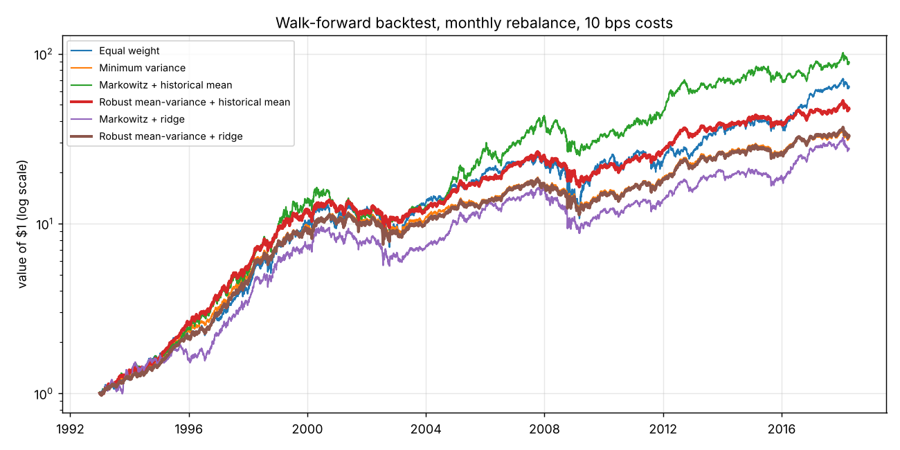

# How much should a portfolio trust a machine-learning model?

Data-science capstone (work in progress): machine-learning forecasts of stock returns, fed into portfolios
that trust them fully (Markowitz) or only partly (KL-robust optimisation).

## The idea

To build a portfolio you need a guess of how much each stock will return. A machine-learning model can make
that guess, but returns are mostly noise and even good models are wrong most of the time. Classic
**Markowitz** optimisation trusts the guess fully, so it bets heavily on the model's mistakes. A
**KL-robust** portfolio lets an adversary reweight the past within a budget ρ (measured by relative entropy,
or KL divergence) and protects against the worst case: ρ is a dial for *how much to trust the model*.

The project asks two questions, and keeps them separate:

1. **ML:** can a model forecast next month's returns better than the historical average?
2. **Decisions:** does a better forecast give a better portfolio, and how much should the portfolio trust it?

## Baseline (already working)

Walk-forward on 10 US stocks, 1993–2018: every month each model is retrained on the past only and predicts
the next month; each portfolio is rebuilt from the forecast, long-only, with 0.1% trading costs.
Full output: [`results/baseline.md`](results/baseline.md).

| forecaster | R² vs zero | rank IC | hit rate |
|---|---|---|---|
| historical mean | −0.014 | 0.058 | 56.6% |
| ridge regression on momentum and volatility | 0.003 | 0.027 | 58.9% |

| portfolio | annual return | volatility | Sharpe | max drawdown | turnover |
|---|---|---|---|---|---|
| Equal weight | 17.9% | 22.5% | 0.84 | −57.8% | 0.00 |
| Minimum variance (no forecast) | 14.7% | 17.0% | 0.89 | −38.6% | 0.08 |
| Markowitz + historical mean | 19.4% | 21.7% | 0.92 | −45.4% | 0.29 |
| Robust + historical mean | 16.5% | 17.6% | 0.96 | −38.3% | 0.14 |
| Markowitz + ridge | 14.0% | 20.6% | 0.74 | −46.3% | 0.57 |
| Robust + ridge | 14.8% | 17.2% | 0.89 | −39.0% | 0.18 |



**First reading.** The ridge model beats the average slightly on R² but orders the stocks worse; fed to
Markowitz it *lowers* the Sharpe ratio from 0.92 to 0.74 and doubles the trading. The robust portfolio
barely notices (0.96 → 0.89): distrusting the model limits the damage of a bad one. The capstone is about
the other half: building forecasts good enough to *help*, and choosing how much to trust them.

## Roadmap (about 14 weeks)

- [ ] **Data and EDA** (weeks 1–3)
  - [ ] more assets and a longer, less biased sample (`download_prices`: ETFs, sectors, an index's members)
  - [ ] market data as features: interest rates, VIX, oil, the dollar
  - [ ] EDA notebook: distributions, fat tails, crises, correlations over time
- [ ] **Features** (weeks 4–6)
  - [ ] ranks across stocks, returns relative to the market, volatility regimes, calendar effects
  - [ ] leakage checks: every feature from the past only (tests in `tests/`)
- [ ] **Models** (weeks 6–9)
  - [ ] linear (ridge, lasso), trees (random forest, gradient boosting), a small neural network
  - [ ] tuning with walk-forward cross-validation (never shuffle time)
  - [ ] a classification version: will the stock beat the others next month?
  - [ ] explain the models (feature importance, SHAP)
- [ ] **Decisions** (weeks 9–11)
  - [ ] sweep ρ for each model: how much trust pays off?
  - [ ] choose ρ on a validation period, test on later years
  - [ ] crisis periods (2000–02, 2008, 2020): who loses least?
- [ ] **Delivery** (weeks 12–14)
  - [ ] interactive dashboard (Streamlit): pick a model and ρ, see the portfolio
  - [ ] presentation and write-up

## Quick start

```bash
python3 -m venv .venv && source .venv/bin/activate
pip install -e ".[notebooks,test]"
python scripts/run_baseline.py        # the tables above, about 20 seconds
jupyter lab notebooks/01_start_here.ipynb
pytest                                # the checks
```

## What is here

```
src/robustfolio/   data.py        prices (bundled file, or Yahoo Finance) and returns
                   features.py    features and target, from the past only
                   forecast.py    historical mean, and any scikit-learn model retrained monthly
                   portfolio.py   equal weight, minimum variance, Markowitz, KL-robust
                   backtest.py    walk-forward scoring of forecasts and of portfolios
                   dro.py         the worst case over a KL ball, with duality/ underneath
notebooks/         01_start_here: the whole pipeline once
scripts/           run_baseline.py
results/           baseline tables and charts
tests/
```

To add a model: wrap any scikit-learn regressor in `SklearnForecaster` and pass it to
`walk_forward_forecasts`, as in the notebook.

## Background and limits

The robust portfolio comes from [kl-dro-spin-glass](https://github.com/zahi-glitch/kl-dro-spin-glass): its
worst case is computed exactly through a Parisi-type dual from spin-glass theory (Kistler–Schmidt–Sebastiani,
J. Phys. A 56 (2023) 294001), which makes it fast enough to rebuild every month for every model.

Limits of the baseline: survivorship bias (well-known companies chosen today), 10 stocks, zero risk-free
rate, one market. Data: [PyPortfolioOpt](src/robustfolio/data/README.md) test prices, MIT licence.
Educational project, not investment advice.
